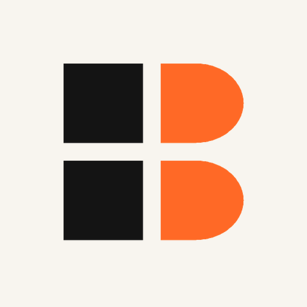
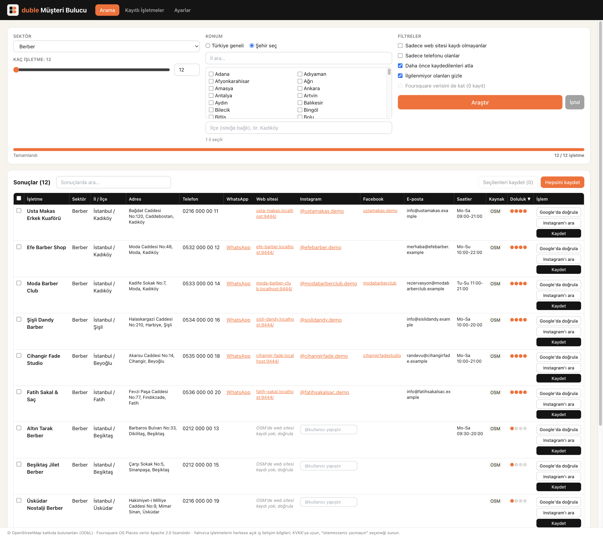
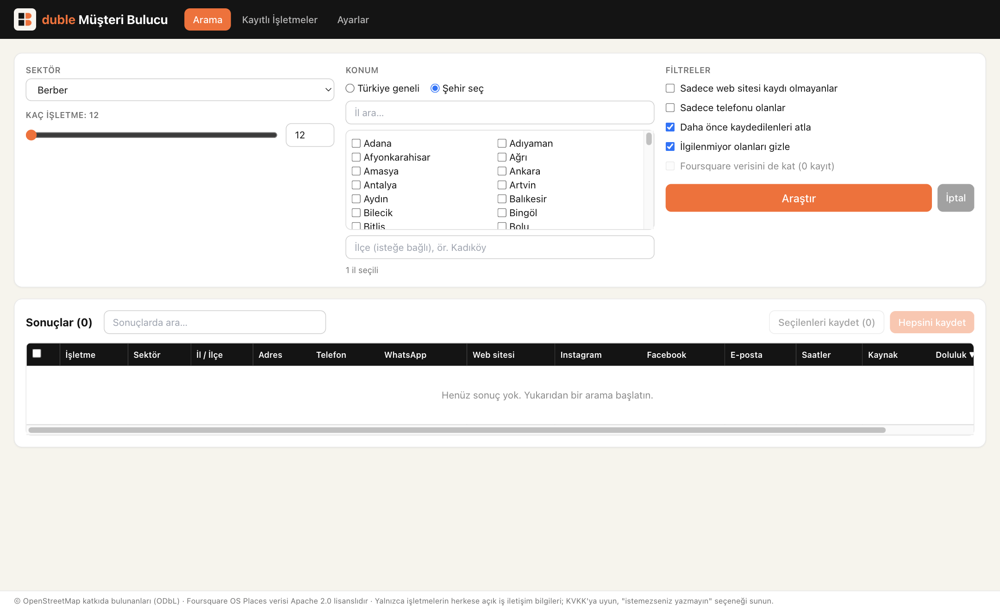
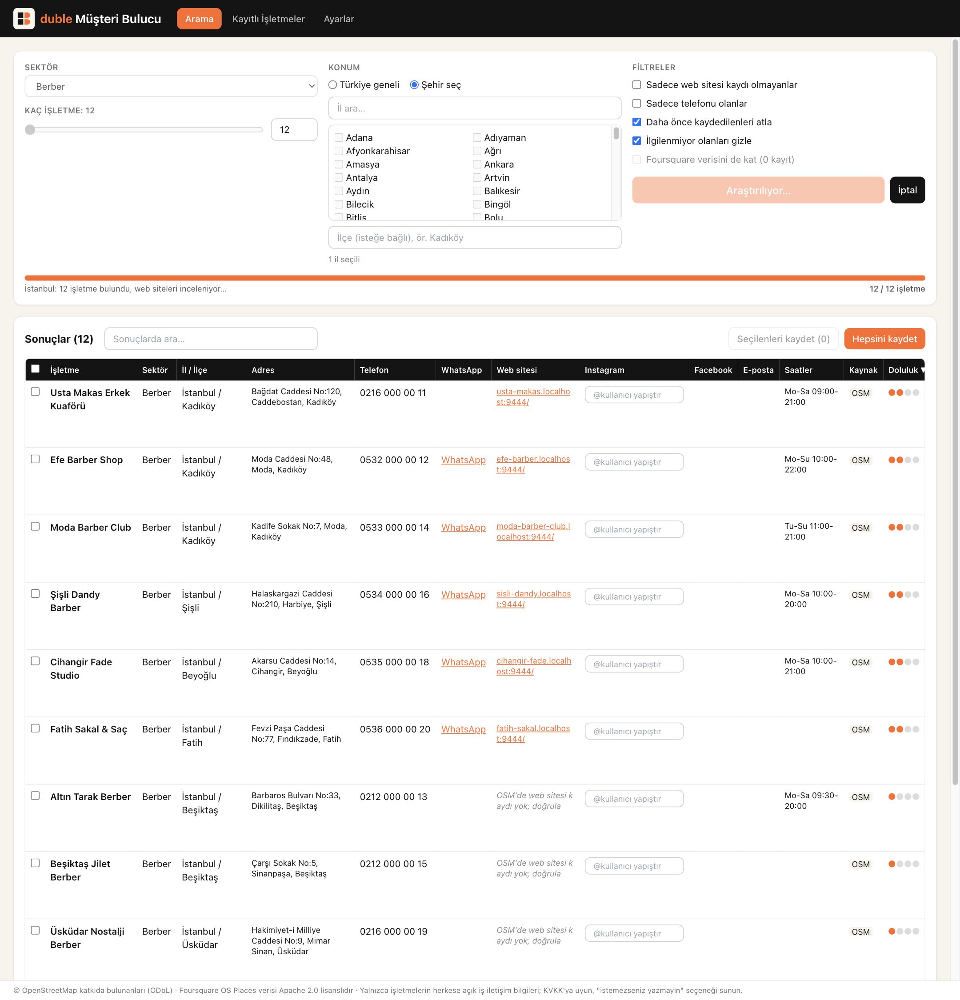
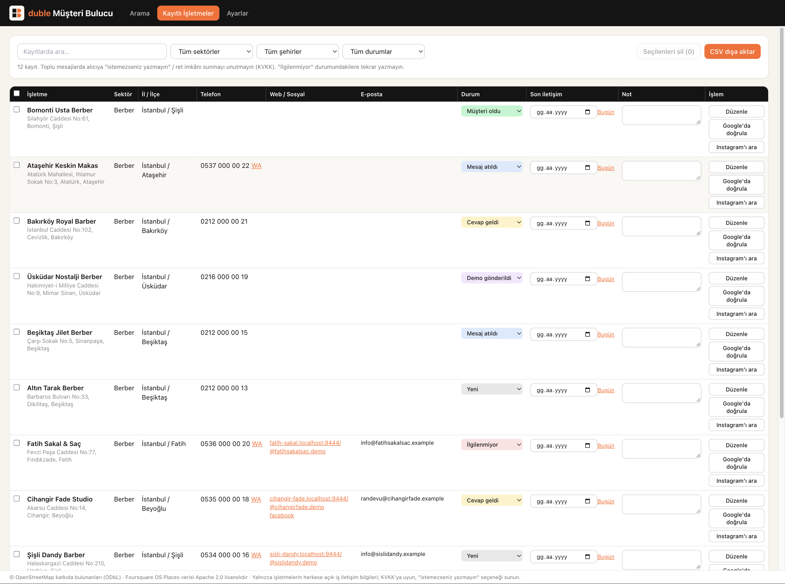
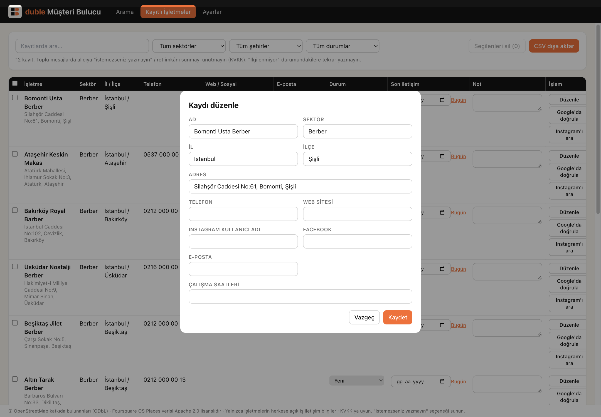
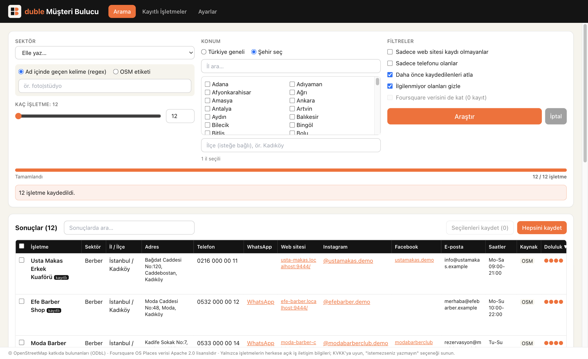
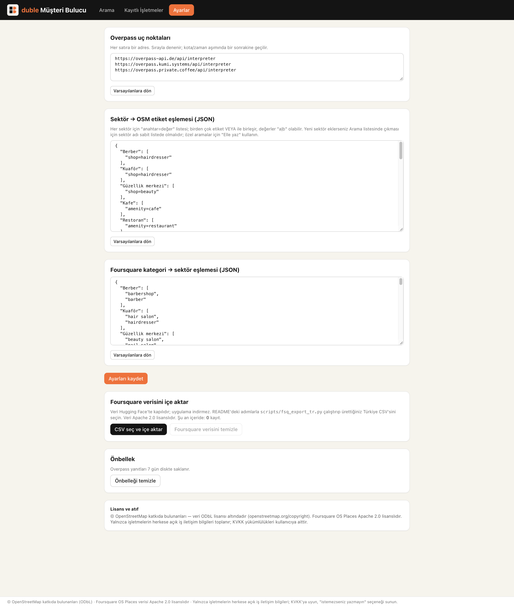
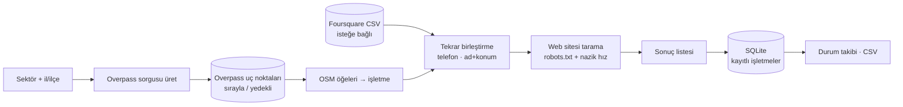

<p align="center">
  
</p>

<h1 align="center">duble Müşteri Bulucu</h1>

<p align="center">
  Ücretsiz açık veri kaynaklarından (OpenStreetMap + isteğe bağlı Foursquare OS Places) Türkiye'deki<br>
  işletmeleri bulan, web sitelerinden iletişim bilgilerini tamamlayan ve satış sürecini takip ettiren masaüstü uygulaması.
</p>

<p align="center">
  
  
  
  
  
</p>



> **Not:** Bu README'deki tüm ekran görüntüleri **kurgusal** işletmelerle üretilmiştir (telefonlar `000` örüntülü, e-postalar `.example` alanında). Gerçek kişi veya işletme verisi içermez. Üretim betiği [`tools/screenshots`](tools/screenshots) altındadır.

## İçindekiler

- [Ne işe yarar?](#ne-işe-yarar)
- [Ekran görüntüleri](#ekran-görüntüleri)
- [Nasıl çalışır?](#nasıl-çalışır)
- [Mimari](#mimari)
- [Kurulum ve çalıştırma](#kurulum-ve-çalıştırma)
- [Otomasyon araçları](#otomasyon-araçları)
- [Foursquare verisi (isteğe bağlı)](#foursquare-verisi-isteğe-bağlı)
- [Etik, KVKK ve veri kaynakları](#etik-kvkk-ve-veri-kaynakları)
- [Depo yapısı ve sınırlamalar](#depo-yapısı-ve-sınırlamalar)

## Ne işe yarar?

Küçük işletmelere (berber, kafe, çiçekçi, emlak…) ulaşmak isteyen biri için potansiyel müşteri listesi çıkarır:

1. **Sektör + konum seçersiniz** (20 hazır sektör, 81 il, isteğe bağlı ilçe; ya da etiket/regex ile elle arama).
2. **Uygulama OpenStreetMap'ten (Overpass API) işletmeleri çeker.**
3. Web sitesi olanların sitesini **nazikçe tarar** ve eksik Instagram / Facebook / e-posta / telefon bilgilerini tamamlar.
4. **Tekrarlayan kayıtları tek kayda birleştirir**, her kayda bir *veri doluluk* puanı (0–4) verir.
5. Beğendiklerinizi **yerel SQLite veritabanına kaydedersiniz**; durum (Yeni → Mesaj atıldı → Cevap geldi → Demo gönderildi → Müşteri oldu / İlgilenmiyor), son iletişim tarihi ve not takibi yaparsınız.
6. Excel uyumlu **CSV** olarak dışa aktarırsınız.

Her şey makinenizde çalışır; hesap, API anahtarı veya sunucu gerekmez.

## Ekran görüntüleri

### Arama
Sektör, kaç işletme, konum ve filtreler (web sitesi olmayanlar, telefonu olanlar, daha önce kaydedilenleri atla, "ilgilenmiyor" olanları gizle).



### Canlı ilerleme ve zenginleştirme
Önce sonuçlar listelenir, ardından web siteleri taranırken satırlar canlı güncellenir (Instagram, e-posta, Facebook sütunları dolar).



### Sonuçlar
Her satırda doluluk göstergesi, WhatsApp bağlantısı (cep numaraları için), "Google'da doğrula" ve "Instagram'ı ara" kısayolları bulunur. Web sitesi kaydı olmayanlarda Instagram kullanıcı adı elle yapıştırılabilir.


### Kayıtlı işletmeler
Mini CRM görünümü: arama, sektör/şehir/durum filtreleri, durum rozetleri, son iletişim tarihi, not ve toplu silme / CSV dışa aktarma.



### Kaydı düzenleme



### Elle arama
Hazır sektör listesinde olmayan bir şey için OSM etiketi (`shop=bakery`) ya da ad üzerinde regex ile arama yapılabilir.



### Ayarlar
Overpass uç noktaları (sırayla denenir), sektör → OSM etiket eşlemesi, Foursquare kategori eşlemesi, önbellek ve veri içe aktarma.



## Nasıl çalışır?



**Önemli davranışlar** (kaynak koddan çıkarılmıştır):

| Konu | Davranış |
|---|---|
| Overpass | Aynı anda tek istek, istekler arası ≥ 2 sn; 429/5xx'te üstel geri çekilme ve yedek uç noktaya geçiş; 90 sn zaman aşımı |
| Önbellek | Overpass yanıtları 7 gün diskte saklanır |
| Tekrar tespiti | Aynı kaynak+kimlik, **aynı telefon (E.164)** veya **ad benzerliği ≥ 0,85 (Dice/bigram) ve ≤ 150 m** mesafe → tek kayıtta birleşir, boş alanlar tamamlanır, alan kaynakları (`OSM`/`FSQ`/`WEB`) korunur |
| Telefon | Türkiye biçimlerini (`0…`, `+90…`, `0090…`, dahili) E.164'e çevirir; `5xx` ise cep sayılır ve WhatsApp bağlantısı üretilir |
| Web tarama | `/`, `/iletisim`, `/contact`, `/hakkimizda`, `/about`; **robots.txt'e uyar**, aynı siteye ≥ 1 sn ara, sayfa başı 1,5 MB sınır, 5 eşzamanlı çalışan |
| Çıkarım | `mailto:`, `tel:`, `wa.me`, Instagram/Facebook bağlantıları ve JSON-LD (`sameAs`, `telephone`, `email`) |
| Doluluk puanı | telefon, web sitesi, Instagram, e-posta sayısı (0–4); sonuçlar buna göre sıralanır |
| CSV | `;` ayraçlı, UTF-8 BOM'lu (Türkçe Excel uyumlu), formül enjeksiyonuna karşı `'` önekli |
| Veritabanı | `musteri-bulucu.db` (SQLite, WAL), sürümlü migrasyonlar; `businesses`, `searches`, `search_results`, `fsq_places` |

## Mimari

```
Electron ana süreç (Node)           Preload (contextBridge)        Renderer (React 19)
├─ ipc.ts      IPC uç noktaları  ◄──►  window.api.*            ◄──►  Arama · Kayıtlı · Ayarlar
├─ search.ts   arama orkestrasyonu
├─ overpass.ts + overpass-query.ts
├─ enrich.ts   web tarama (cheerio)
├─ fsq.ts      Foursquare CSV içe aktarma
├─ db.ts       better-sqlite3
└─ shared/     telefon, extract, merge, cities, sectors, csv
```

- **Güvenlik:** `contextIsolation: true`, `nodeIntegration: false`, `sandbox: true`, sıkı CSP; harici bağlantılar yalnızca `http(s)` ve `shell.openExternal` ile açılır; pencere içi gezinme engellenir.
- **IPC:** tüm çağrılar `{ ok, data | error }` zarfına sarılır; hatalar Türkçe mesajla arayüze döner.
- **Kullanıcı verisi:** `~/Library/Application Support/duble Müşteri Bulucu/` (veritabanı, `settings.json`, `cache/`).
- **Yerleşik duman testi:** `DUBLE_SELFTEST=1` ile başlatıldığında gerçek Overpass'a bir sorgu atar ve veritabanını dener.

## Kurulum ve çalıştırma

Gereksinimler: **Node 22+**, macOS (arm64 için test edildi).

```bash
npm install        # Electron'u indirir, better-sqlite3'ü Electron için derler
npm start          # uygulamayı geliştirme modunda açar
```

Paketlenmiş hazır `.app` yerel olarak `release/` altında durur (boyutu ~300 MB olduğu için git'e eklenmez; dağıtım için GitHub Releases'e zip olarak yüklemeniz önerilir):

```bash
open "release/Duble Musteri Bulucu.app"
```

Kaynaktan yeniden paketlemek için:

```bash
npm run pack:mac
```

> `npm install` / `npm start` / `pack:mac` adımları bu depo oluşturulurken **çalıştırılıp doğrulanmadı**; yalnızca paketlenmiş `.app` ve ekran görüntüsü otomasyonu uçtan uca çalıştırıldı.

## Otomasyon araçları

README görselleri elle değil, betikle üretilir; arayüz değiştiğinde tek komutla yenilenir:

```bash
npm run screenshots                       # release/ altındaki .app ile
node tools/screenshots/capture.mjs <yol>  # başka bir uygulama ikilisiyle
```

- [`tools/screenshots/mock-server.mjs`](tools/screenshots/mock-server.mjs): kurgusal Overpass yanıtı + `*.localhost` üzerinde sahte işletme siteleri. Uygulamanın **gerçek** arama, birleştirme ve web tarama hattı bunlara karşı çalışır.
- [`tools/screenshots/capture.mjs`](tools/screenshots/capture.mjs): uygulamayı **geçici** bir veri klasörüyle (gerçek kayıtlarınıza dokunmadan) başlatır, Chrome DevTools Protocol ile arayüzü sürer ve `docs/screenshots/` altına PNG yazar. Ek bağımlılık yoktur.
- `npm run mock`: sahte sunucuyu tek başına çalıştırır; uygulamada Ayarlar → Overpass uç noktasına `http://127.0.0.1:9444/api` yazarak güvenle deneme yapabilirsiniz.

## Foursquare verisi (isteğe bağlı)

Ayarlar → *Foursquare verisini içe aktar* ile Foursquare OS Places'ten üretilmiş bir CSV yüklenebilir; bu kayıtlar OSM sonuçlarıyla birleştirilir. Beklenen sütunlar: `fsq_place_id, name, address, locality, region, postcode, country, tel, website, email, instagram, facebook_id, fsq_category_labels, latitude, longitude` (`country` `TR` olmalı). Arayüz bu CSV'yi üreten `scripts/fsq_export_tr.py` betiğinden söz eder; **o betik paketlenmiş uygulamada yoktu, bu depoda da bulunmuyor.**

## Etik, KVKK ve veri kaynakları

- Yalnızca işletmelerin **herkese açık iş iletişim bilgileri** toplanır; robots.txt'e uyulur, istek hızı sınırlıdır, kullanıcı aracısı kendini tanıtır (`dubleMusteriBulucu/1.0`).
- Toplu mesajlarda alıcıya **"istemezseniz yazmayın"** seçeneği sunun; **"İlgilenmiyor"** durumundaki kayıtlara tekrar yazmayın (uygulama bunları aramalarda gizleyebilir). Uyum sorumluluğu kullanıcıdadır.
- Veri: © OpenStreetMap katkıda bulunanları ([ODbL](https://www.openstreetmap.org/copyright)); Foursquare OS Places: Apache 2.0.
- Ortak Overpass sunucularını yormayın; uygulamanın hız sınırlarını gevşetmeyin.

## Depo yapısı ve sınırlamalar

```
app/                  paketlenmiş uygulamadan çıkarılan derlenmiş kod (out/main, out/preload, out/renderer) + package.json
tools/screenshots/    ekran görüntüsü otomasyonu (sahte sunucu + CDP sürücüsü)
docs/                 logo ve ekran görüntüleri
release/              paketlenmiş .app (git dışı)
```

- **Özgün TypeScript kaynağı bu depoda yok.** `app/out/` dizini, `.app` içindeki `app.asar` arşivinden çıkarılan derleme çıktısıdır: ana süreç kodu okunabilir durumdadır, arayüz (renderer) paketi ise küçültülmüştür. Düzenli geliştirme için özgün kaynak (`src/main`, `src/shared`, `src/renderer`) varsa onu eklemek gerekir.
- Uygulama yalnızca **Türkiye** için tasarlanmıştır (il listesi, telefon biçimleri).
- Sahte sunucu ve ekran görüntüsü betiği macOS'ta denenmiştir.

## Lisans

[MIT](LICENSE)
